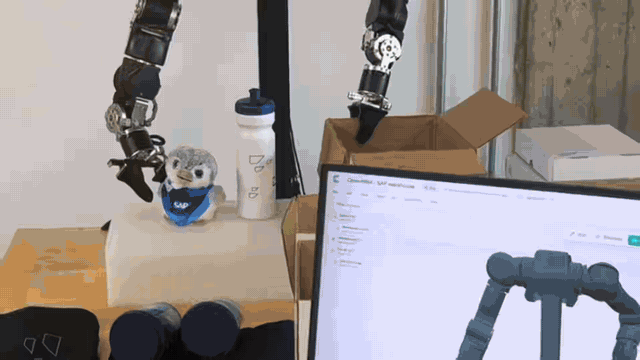

<p align="center">
  <a href="https://cyberwave.com">
    
  </a>
</p>

<h1 align="center">Cyberwave Python SDK</h1>

<p align="center">
  <b>Making the physical world programmable.</b><br/>
  Connect, control, and simulate any robot. The same code runs in simulation and on real hardware.
</p>

<p align="center">
  
</p>

<p align="center">
  <a href="https://github.com/cyberwave-os/cyberwave-python/blob/main/LICENSE"></a>
  <a href="https://docs.cyberwave.com"></a>
  <a href="https://discord.gg/dfGhNrawyF"></a>
  <a href="https://pypi.org/project/cyberwave/"></a>
  <a href="https://pypi.org/project/cyberwave/"></a>
  <a href="https://github.com/cyberwave-os/cyberwave-python/actions/workflows/test.yml"></a>
</p>

---

Cyberwave is an all-in-one platform for building and deploying intelligent physical AI agents. 
Connect a physical robot or sensor, test it in simulation, and run AI models; all through one Python SDK.
This package is the official client.

## Installation

```bash
pip install cyberwave
```

Optional features install via extras, e.g. `cyberwave[camera]` (video streaming),
`cyberwave[ml]` (vision models), or `cyberwave[zenoh]` (edge data bus). See the
[installation docs](https://docs.cyberwave.com/overview) for the full list.

## Quick Start

Get an API key from your Cyberwave instance (**Profile → API Tokens**) and export it:

```bash
export CYBERWAVE_API_KEY="your_api_key_here"
```

A token scoped to more than one workspace also needs to know which one you mean.
Set it once and every request carries it:

```bash
export CYBERWAVE_WORKSPACE_ID="your_workspace_uuid"   # or Cyberwave(workspace_id=...)
```

You can skip this for a token scoped to a single workspace — there is nothing to
disambiguate. Without it, a multi-workspace token gets back
`400 workspace_required`, listing the workspaces the token holds.

Then create and control your first digital twin:

```python
from cyberwave import Cyberwave

cw = Cyberwave()  # reads CYBERWAVE_API_KEY from the environment

# Create a digital twin from a catalog asset.
# Pin it with canonical slugs. UUID values remain accepted for compatibility.
# Omit both and Cyberwave creates a "Quickstart Environment" for you automatically.
arm = cw.twin(
    "the-robot-studio/so101",
    twin_id="acme/twins/arm-station-1",
    environment_id="acme/envs/production-floor",
)

# Place it in the scene (editor layout)
arm.edit_position(x=1.0, y=0.0, z=0.5)
arm.edit_rotation(yaw=90)  # degrees

# Move a joint by name
joint_names = arm.joints.list()
if joint_names:
    arm.set_joints({joint_names[0]: -0.2})  # radians
    print(arm.get_joints())

# Drive a locomotion twin in simulation
cw.affect("simulation")          # or cw.affect("live") for the real robot
rover = cw.twin("unitree/go2")
rover.move_forward(0.3)

cw.disconnect()
```

The same script targets real hardware by switching `cw.affect("live")`, no other changes.

## Core Concepts

- **Twins** — virtual representations of robots and sensors. You develop and test against a twin, then deploy to hardware with identical code. Instantiate any catalog asset with `cw.twin("vendor/slug")`.
- **Environments** — scenes your twins live in. Validate quickly in the browser-based Playground, or use MuJoCo for high-fidelity physics and RL.
- **Simulation vs. live** — `cw.affect("simulation")` and `cw.affect("live")` switch where commands and state go. The same code drives both.
- **Edge & cloud** — stream camera/sensor data and run AI models on the edge or in the cloud, without managing the infrastructure in between.
- **Aerial twins** — `takeoff()`, `land()`, and `hover()` record the flight state Cyberwave gates on, so a second `takeoff()` on an airborne aircraft is refused rather than sent. If you fly a drone without those helpers, record the intent with `twin.set_hovering_status(hovering=True, hovering_altitude=2.0)` (or `client.twins.set_flight_request(twin_uuid, hovering=True)`) — not with `twins.update(metadata=...)`, which overwrites the state the aircraft itself reports. See the [Drone commands](https://docs.cyberwave.com/feature-reference/drone-commands) docs.
- **GPS positioning** — a twin with a GNSS receiver can be placed in a georeferenced environment from its own fixes. Publish them with `client.mqtt.update_twin_gps(...)` (or `publish_gps()` from an edge node) and read them with `twin.gps.get_fix()`. Live only: `get_fix()` raises in simulation, because no simulation backend produces GPS. Set the environment's geo reference first — see the [Geo reference](https://docs.cyberwave.com/feature-reference/environment-editor/geo-reference) docs.
- **Drivers** — subclass `BaseDriver` (or ship `cw-driver.yml`) so the dashboard **Keyboard (Driver)** controller lists this twin's commands. Discrete commands fire once; mark locomotion `continuous` if a held key should repeat. See the [Keyboard (Driver)](https://docs.cyberwave.com/feature-reference/environment-editor/teleoperation#keyboard-driver) docs.
- **Calibration** — when a camera is mounted on an arm, `cyberwave.calibration` measures where it actually sits instead of you entering the offset by eye. See the [hand-eye calibration guide](https://docs.cyberwave.com/feature-reference/hand-eye-calibration).

## Demos

Watch the SDK in action with our demos.

<table>
  <tr>
    <td width="50%">
      <a href="https://youtu.be/kUxSxCMCQgc">
        
      </a>
      <br/>
      <b><a href="https://youtu.be/kUxSxCMCQgc">Build a natural language voice agent on SO101</a></b>
    </td>
    <td width="50%">
      <a href="https://youtu.be/ITz9zMf0ObA">
        
      </a>
      <br/>
      <b><a href="https://youtu.be/ITz9zMf0ObA">Controlling a DJI Mini 4 Pro with the Cyberwave Python SDK</a></b>
    </td>
  </tr>
</table>

## Examples

Runnable scripts live in [examples/](examples) and see the [examples index](examples/README.md) for the full list.

| Example | Shows |
| --- | --- |
| [quickstart.py](examples/quickstart.py) | Create a twin, scene layout, joints, locomotion |
| [joints.py](examples/joints.py) | Read and write joint positions by name |
| [locomotion.py](examples/locomotion.py) | Velocity-style locomotion commands |
| [capture_frame.py](examples/capture_frame.py) | Grab a single camera frame from a twin |
| [handeye_calibration.py](examples/handeye_calibration.py) | Measure where a wrist camera sits on an arm |
| [notebooks/hand_eye_calibration.ipynb](examples/notebooks/hand_eye_calibration.ipynb) | The same, as a runnable notebook — works in Colab with no robot attached |
| [notebooks/g1_voice_astra.ipynb](examples/notebooks/g1_voice_astra.ipynb) | Voice command + live G1 camera frame + GPT-6 Astra, with bounded motion tools and a preview mode |
| [camera_stream.py](examples/camera_stream.py) | Stream a camera feed over WebRTC |
| [drone_hovering.py](examples/drone_hovering.py) | Takeoff, hover, and land a flying twin |
| [workflows.py](examples/workflows.py) | List, trigger, and monitor workflows |
| [ai/yolo.ipynb](examples/ai/yolo.ipynb) | Run YOLO vision models (Colab) |

## Documentation

Full guides and the complete API reference are at **[docs.cyberwave.com](https://docs.cyberwave.com)**
([overview](https://docs.cyberwave.com/overview) ·
[API reference](https://docs.cyberwave.com/api-reference/overview)).

## Listing recordings

`recordings.list()` is paged. With no `start`/`end` it lists the most recent day
that has recordings instead of the environment's whole history, and it returns
at most `limit` rows (default `200`, fetched 50 per request). Pass `limit=0` to
follow every page.

Like the replay picker, listing excludes materializing or failed recordings by
default. Pass `include_unready=True` only when a caller needs those rows — it
requires elevated access, and the server rejects the call with HTTP 403 rather
than silently returning ready rows.

```python
items = cw.environments.recordings.list(environment_id="acme/envs/floor")
items = cw.environments.recordings.list(
    environment_id="acme/envs/floor",
    start="2026-07-01",
    end="2026-07-05",
    limit=0,
)
```

Whenever the result is partial — scoped to one day, or cut short by `limit`
while the server still had pages — `list()` logs a warning naming the window and
telling you which argument widens it, so a truncated list never looks complete.

If Cloud Run rejects a catalog response at its payload-size boundary, the SDK
raises `RecordingPayloadTooLargeError` with the affected window, cloud trace,
and a concrete retry hint. Restrict `start`/`end` or lower `limit` and retry.

### Migrating to 0.7.0

`recordings.list()` with no arguments returns the most recent day that has
recordings, rather than the environment's whole history. An unbounded listing
could exceed the API gateway's response ceiling on a busy environment and fail
with an opaque HTTP 500. It affects `twin.recordings.list()` and
`cw.environments.recordings.list()` equally.

The behavior itself shipped in **0.6.6**. `0.7.0` adds no further change to it —
the version is bumped to a minor purely to label the break, which 0.6.6 should
have done. If you are pinned to `0.6.6` you already have the new behavior; if
you are on `<= 0.6.5`, the table below is your upgrade.

| Argument | `<= 0.6.5` | `>= 0.6.6` |
| --- | --- | --- |
| `start` / `end` omitted | Every day in the environment's history | Only the most recent day that has recordings |
| `include_unready` | Materializing and failed rows included by default | `False` — ready rows only |
| `limit` | One response, server-capped at 100 rows | `200`, fetched 50 per request |

To widen the window again, name it explicitly and lift the cap. `limit=0` alone
is not enough, because the implicit single-day window is applied first, and both
bounds are required together:

```python
items = cw.environments.recordings.list(
    environment_id="acme/envs/floor",
    start="2026-01-01",           # both bounds are required together
    end="2026-07-05",
    limit=0,                      # follow every page in that window
)
```

There is no argument that means "all history": pick a `start` early enough to
cover the range you care about. Callers that only need "the latest recordings"
need no change — that is the default.

`include_unready=True` requires elevated access. Without it the server rejects
the call with HTTP 403 rather than quietly returning ready rows, so do not add
it speculatively.

## Recording readiness

Recording list items expose the server's playback assessment when it is
available. Use `is_playback_ready` before downloading artifacts, or request
unready entries explicitly while building a retry UI:

```python
items = cw.environments.recordings.list(
    environment_id="acme/envs/floor",
    include_unready=True,
)

for item in items:
    print(item.uuid, item.readiness, item.is_playback_ready)
```

`item.readiness` is `None` when connected to a server that predates this
feature. If `get()` receives a materializing response, it raises `CyberwaveError`
with the server's suggested retry interval instead of returning an empty
recording.

## Timestamped virtual camera sources

`VirtualCameraStreamer` accepts RGB arrays as before. For an asynchronous
renderer or camera, return a `CapturedVideoFrame` from `get_frame` so pixels
retain their acquisition time when the stream sends the same image again:

```python
from cyberwave.sensor import CapturedVideoFrame
from cyberwave.utils import monotonic_seconds

# In your acquisition callback, with the source's measured clocks. Where the
# source has no clock of its own, read the monotonic half from
# monotonic_seconds(): that is the clock the rest of the SDK stamps with, and
# unlike time.monotonic() it keeps running while the host is suspended.
latest = CapturedVideoFrame(rgb, capture_wall_time, capture_monotonic, acquisition_id)

# Pass this callback as get_frame to VirtualCameraStreamer.
def get_frame():
    return latest
```

Create the sample once per acquisition and increase `acquisition_id` even when
the scene is stationary. Use Unix seconds for `capture_wall_time` and monotonic
seconds for `capture_monotonic`, measured when the source state is acquired,
not when rendering or encoding finishes. The sample owns a read-only RGB copy.
Return the same sample until a new acquisition, or `None` while unavailable.
Repeated sends are not fresh captures; placeholders have no capture timestamp.
This preserves source timing, but does not by itself verify recording/Replay
synchronization.

## Fetching a recording

`get()` downloads a recording's artifacts into a temp directory. A long recording
is stored as many parts; they are fetched in parallel and handed back in timeline
order whenever the server labels each part's position:

```python
with cw.environments.recordings.get(items[0]) as rec:
    rec.local_paths          # downloaded parts per stream, in playback order

# Fetch serially, or fetch less
rec = cw.environments.recordings.get(items[0], max_workers=1)
rec = cw.environments.recordings.get(items[0], path=".parquet")
```

`max_workers` defaults to 8 and is capped at 32; pass `1` for a strictly serial
fetch. The gain scales with how many parts a recording has — one stored as a
single large file gains nothing from extra workers.

`path` keeps only the artifacts whose signed URL or filename contains the given
text, so it selects by file extension rather than by stream: `".parquet"` fetches
the tables and skips `.mp4` video, which is usually most of a camera recording's
bytes. A reader whose artifact was filtered out raises rather than returning
empty.

## Governed commands: the command gateway

`POST /api/v1/twins/{uuid}/commands` is the platform's one server-side ingress
for twin commands: it checks the token scope, the caller's role, the twin's
control policy, operator grants and the catalog's typed arguments, writes an
audit record for every decision, and only then publishes the command. With
`timeout_s > 0` it also waits for the driver's reply.

```python
result = twin.commands.send("takeoff", {"altitude_m": 30}, timeout_s=10)
result.status      # "accepted", "rejected", "denied", "timeout", "sent", "no_response", ...
result.reason      # why, for anything but accepted/sent
result.audit_id    # the audit record written for this decision

twin.commands.audit(limit=20, decision="denied")["items"]
twin.commands.control_policy.get()            # or twin.commands.control_policy()
twin.commands.control_policy.put("limited", allowed_commands=["arm", "takeoff"], governed=True)
grant = twin.commands.grants.create(operator_uuid, duration_s=3600)
twin.commands.grants.revoke(grant["uuid"])

# The same, keyed by twin UUID:
cw.commands.send(twin_uuid, "land", timeout_s=5)
```

Policy denials, publish failures and driver refusals come back as a
`CommandResult`, not as exceptions; `CyberwaveAPIError` means the request itself
failed. On a *governed* twin (`governed=True`) the broker refuses direct
publishes on the twin's command topic, so `twin.commands.<name>()` and
`request_command` no longer reach the driver there: use `twin.commands.send`.
`send`, `request`, `audit`, `control_policy`, `grants` and `gateway` are
reserved on `twin.commands`; a catalog command with one of those names is sent
with `twin.publish_command(name, data)`.

## MQTT v5 command request/response

Over MQTT v5 a command can carry a Response Topic and Correlation Data, and the
driver answers with one `twin.command_response.v1` payload
(`accepted` / `rejected` / `denied` / `timeout`):

```python
reply = cw.mqtt.request_command(twin_uuid, "arm", {}, timeout_s=5)
reply = twin.commands.request("arm", timeout_s=5)  # same thing
```

The reply inbox is `{prefix}cyberwave/twin/{twin_uuid}/command/{client_id}/response`;
only this client can read it. Requests need MQTT v5, which is the default; a
client set to 3.1.1 (`CYBERWAVE_MQTT_PROTOCOL=311`) raises `CyberwaveMQTTError`
from `request_command` and `request`. No reply within
`timeout_s` raises `CommandResponseTimeoutError` (a driver that predates the
contract never replies; a governed twin refuses the publish). Raw subscribers
that need the v5 properties can mark a handler with
`cyberwave.mqtt.pass_message`; it is then called as `handler(data, message)`.

### Request/response on any topic

`request_command` is the twin-command case of a generic pattern. For any other
topic pair, `cw.mqtt.request` publishes a request carrying a Response Topic and
Correlation Data, and returns the first message on the reply topic that echoes
that Correlation Data (JSON-decoded when it is JSON):

```python
prefix = cw.mqtt.topic_prefix
reply = cw.mqtt.request(
    f"{prefix}cyberwave/twin/{twin_uuid}/planner/request",
    {"goal": "dock"},
    # A reply topic names this client's id, so only this client can read it.
    response_topic=(
        f"{prefix}cyberwave/twin/{twin_uuid}/planner/{cw.mqtt.client_id}/response"
    ),
    timeout_s=5,
)
```

No reply within `timeout_s` raises `RequestTimeoutError`
(`CommandResponseTimeoutError` is a subclass). On the responder side,
`cyberwave.mqtt.request_response.reply_to(paho_client, request_message, payload)`
publishes to the request's Response Topic and echoes its Correlation Data. It
publishes nothing when the request has none, so v3.1.1 publishers are
unaffected. A responder that must not be steered by a requester validates the
Response Topic itself and passes the result as `topic=`.

Which topics may carry replies is the broker's ACL decision. Under a twin, joint
or environment, any `cyberwave/{type}/{uuid}/.../{client_id}/response` topic is a
reply inbox: only the client named in it may read it, and whoever may write to
the resource may publish to it. Put the reply topic under the resource the
request concerns and name the requester in it, as in the example above. Use one
reply topic per requester, not one per request: each distinct one is a broker
subscription the client keeps for its lifetime, and the Correlation Data already
tells concurrent requests apart. A reply topic elsewhere needs an ACL rule of its
own.

### Replying from a driver

`BaseDriver` builds a `CommandRequest` for every command it dispatches. A
listener receives it by taking a second argument, or replies by returning a
`CommandOutcome`; one-argument listeners are called exactly as before:

```python
from cyberwave.driver import CommandOutcome, CommandRequest

async def _on_arm(self, envelope, ctx: CommandRequest):
    if not self.link_up:
        ctx.reject("vehicle link is down")          # before it reached the device
        return
    ok, text = await self.vehicle.arm()
    ctx.reply("accepted" if ok else "denied", text)  # exactly one reply counts

async def _on_disarm(self, envelope):
    return CommandOutcome.accept()
```

A command without a Response Topic (v3.1.1, or fire-and-forget) gets no reply:
`ctx.expects_reply` is `False` and `ctx.reply()` returns `False`. Replies are
only sent to this twin's reply inbox. `cyberwave.driver.current_command()`
returns the request being handled; `cyberwave.mqtt.command_response` has the
payload builder and topic rules for drivers that do not use `BaseDriver`.

## Structured metrics

A metric channel is a timeseries of one float, int or bool. Publish one sample
per call, on its own topic (`cyberwave/twin/<uuid>/metrics/arm/gripper/force_n`):

```python
client.mqtt.publish_metric(twin_uuid, "arm.gripper.force_n", 12.5)
client.mqtt.publish_metric(twin_uuid, "arm.gripper.closed", True)
```

or several at once in the `metrics` bag, which is also merged into the twin's
metadata and fires `metrics` workflow triggers:

```python
client.mqtt.publish_metrics(twin_uuid, {"cycle_count": 3, "motor_on": True})
```

Anything but a finite float (below 2**63 in magnitude), a 64-bit int or a bool
raises before it is sent; numpy scalars are converted. The latest value of each
channel is under `channels` in `GET /twins/<uuid>/metrics/latest`. Every sample
is stored as a row, at the rate you publish it, in the cloud and on self-hosted
(Enterprise) deployments alike. A channel sample fires no workflow.

## H.264 over RTP ingest

`cyberwave.sensor.rtp_h264` receives an H.264/RTP/UDP push (IP cameras, payload
or ground stations, `ffmpeg -f rtp`, GStreamer `rtph264pay`) and depayloads it
(RFC 6184 single NAL, STAP-A, FU-A) into whole access units, with no re-encode.
It is stdlib-only. Loss drops frames until the next IDR, cached SPS/PPS (in-band
or from `sprop-parameter-sets`) are re-inserted before keyframes, and an SSRC
change resynchronises. `RtpH264CameraStreamer` forwards the stream to the twin
over WebRTC:

```python
from cyberwave.sensor import RtpH264CameraStreamer

streamer = RtpH264CameraStreamer(
    cw.mqtt, bind="0.0.0.0:5600", twin_uuid=twin.uuid, camera_name="main"
)
await streamer.run_with_auto_reconnect(subscribe_to_commands=False)
```

It waits for the first keyframe before offering the stream and advertises the
resolution from the SPS. For custom pipelines, use `UdpRtpReceiver.get_packet`
as the `get_packet` of `H264PacketCameraStreamer`.

## LAN-only WebRTC (on-prem and offline sites)

By default the SDK's peer connections use STUN and the Cyberwave TURN relay.
Set `CYBERWAVE_WEBRTC_ICE_MODE=lan` on sites without internet access: every
SDK peer connection (camera, microphone, multimedia streamers and video
consumers) then gathers host candidates only, with no STUN or TURN server, even
if `turn_servers` or an edge TURN override is configured. Both ends must be
able to reach each other's LAN addresses directly. Unset (or `default`) keeps
the current behaviour.

## Stress-testing an arm driver

`cyberwave-stress-test` ships with the SDK. It tests your driver on its real twin, with no
per-robot test code: it reads the twin's capabilities, command catalog,
universal schema joints and limits, and `state/motion`, then runs only the test
sections that match. Every section passes or fails on measured feedback, and
results are matched to commands by the driver's `motion_id`. Every command the
driver exposes must be tested: `--list` shows each catalog command as tested,
not selected or untested, and an untested command stops the run unless it is
named in `--allow-untested`.

```bash
cyberwave-stress-test --uuid <twin-uuid> --list          # print the plan; nothing moves
cyberwave-stress-test --uuid <twin-uuid> --yes           # run it (moves the robot)
cyberwave-stress-test --uuid <twin-uuid> --sections joints,planned --report ./run/report.json --yes
```

Targets stay inside the joint limits and a Cartesian box, a failed section ends
in `stop` and a measured hold, and Ctrl-C always ends in `stop`. The report
(`report.json`, `events.jsonl`, `joints.csv`) lists every section as passed,
failed or skipped with its reason. A new capability gets a section with the
`@section` decorator of `cyberwave.test.driver_testing`. See
[Stress-testing your driver](https://docs.cyberwave.com/feature-reference/edge/drivers/stress-testing-your-driver).

## Compatibility notes for the next release

**The SDK now connects to the MQTT broker with protocol v5 by default** (it was
3.1.1). Cyberwave's own brokers support v5, and it is what the platform's other
components already use. It lets broker-side echo filtering (`no_local`) and
request/response work without extra setup. A broker that does not support v5
(for example an on-premises 3.1.1-only broker) now refuses the connection; set
`CYBERWAVE_MQTT_PROTOCOL=311` (or pass `mqtt_protocol=paho.mqtt.client.MQTTv311`)
to keep the old behaviour. `request()` and `request_command()` need v5 and raise
`CyberwaveMQTTError` on a client set to 3.1.1. The C++ SDK's default is unchanged.

**REST calls now time out instead of waiting forever.** A call that does not
pass `_request_timeout` gets a 10 s connect timeout and a 300 s read timeout.
The read timeout bounds the wait for the response and each gap while it
arrives, not the whole call, so a slow download that keeps moving data is not
cut off. A call that sends a body (an upload, a JSON payload) has no connect
timeout, since urllib3 would also apply it to sending the body.
Before, a connection left half-open by a network drop could hang the caller for
good. To change the read timeout, set `CYBERWAVE_API_TIMEOUT=<seconds>` or pass
`Cyberwave(timeout=...)`; fractions are fine, `0` restores the old unbounded
behaviour, and a negative or non-numeric value is ignored with a warning.
`_request_timeout` on a single call still wins.

`depth_to_colored_pointcloud` now checks its declared encoded-depth input: with
`output_mode="normalized_uint16"` (the default) or `"metric_mm"`, the array must
have NumPy `uint16` storage. Implicit conversion from an integer list or another
dtype is no longer accepted. Validate the encoded values and convert them to
`uint16` before calling; do not reinterpret metre-valued floats as encoded depth.
`depth_array_to_meters` accepts metre-valued float arrays with `output_mode=None`.
The encoding alone does not establish metric calibration or a world-space pose.

Host `ZENOH_MODE` settings are validated only when Zenoh is selected and enabled.
An unused host value no longer prevents filesystem or MQTT-only drivers from
starting. Active Zenoh sessions still require a supported `peer` or `client` mode.

`twin.commands` now reserves `send`, `request`, `audit`, `control_policy`,
`grants` and `gateway` for the command gateway, so a catalog command with one of
those names is no longer bound as `twin.commands.<name>()`; publish it with
`twin.publish_command(name, data)`. `BaseDriver` command listeners that declare
two required positional parameters (or an optional second one named
`ctx`/`context`/`request`) now receive a `CommandRequest` as the second argument.

## Contributing

Contributions are welcome. Please open an
[issue](https://github.com/cyberwave-os/cyberwave-python/issues) or a pull request.

## Support

- **Documentation**: [docs.cyberwave.com](https://docs.cyberwave.com)
- **Issues**: [GitHub Issues](https://github.com/cyberwave-os/cyberwave-python/issues)
- **Community**: [Discord](https://discord.gg/dfGhNrawyF)

## License

Released under the [MIT License](LICENSE).

### Asset kits

Create reusable robot/accessory assemblies with `client.assets.create_kit(name,
components, workspace_uuid=...)`. Components specify `key`, `asset_uuid`, optional
`parent_key` and `attach_to_link`, `position` in metres `[x,y,z]`, and quaternion
`rotation` `[w,x,y,z]`. List parents before children, with exactly one root and
2–50 individual assets. Use `get_kit(uuid)` or `update_kit(...)` to inspect or
replace the definition. `instantiate_kit(uuid, environment_uuid)` atomically
creates and returns all docked twins; edits do not affect existing deployments.
When updating, omit `description` or `visibility` to preserve its current value.
See [Asset kits](https://docs.cyberwave.com/feature-reference/catalog/asset-kits).
